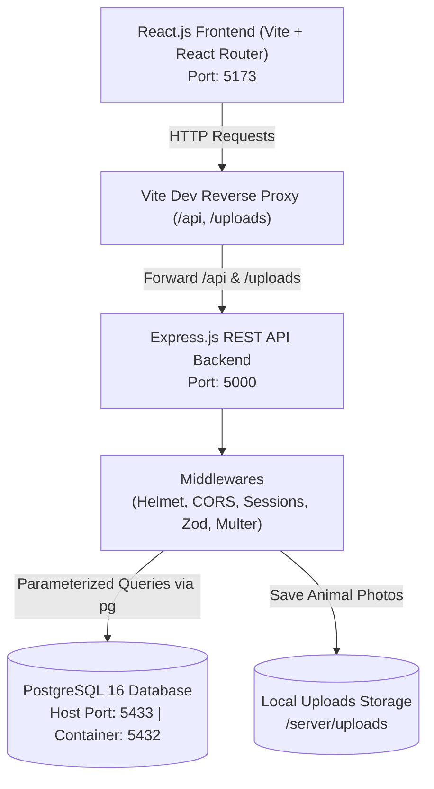
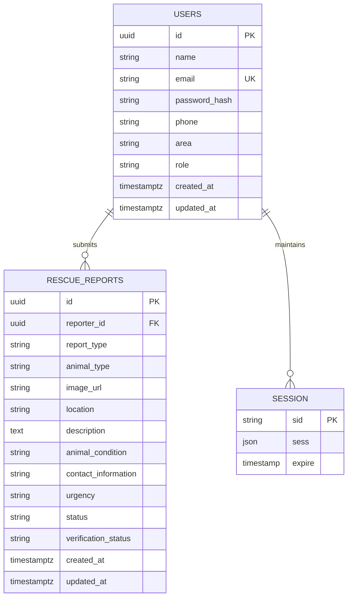

# PawPal — Animal Rescue & Pet Care Management Platform

**Course:** CSE-4113: Internet Programming Lab  
**Department:** Computer Science and Engineering, University of Dhaka  
**Team:** QuadrupleA  
**Technology Stack:** PostgreSQL, Express.js, React.js (Vite), Node.js (PERN Stack)

---

## 🐾 Project Overview
PawPal is a full-stack, web-based animal rescue and pet-care management platform designed to improve animal welfare, rescue coordination, and everyday pet-care practices in Bangladesh. It bridges the gap between chaotic social media groups and real-time on-the-ground rescue operations.

---

## 🏛️ System Architecture Flow



---

## 🗄️ Database Entity-Relationship Diagram (Phase 1)



---

## 👥 Four-Member Sequential Architecture
1. **Phase 1 (Member 1):** Project Foundation, Authentication, Direct Upload & Basic Reporting (`feature/01-foundation-auth`)
2. **Phase 2 (Member 2):** Advanced Rescue Workflows & Volunteer Coordination (`feature/02-rescue-volunteers`)
3. **Phase 3 (Member 3):** Pet Health Management & Veterinary Directory (`feature/03-pet-health-clinics`)
4. **Phase 4 (Member 4):** Knowledge Hub, Admin Moderation & Final Integration (`feature/04-knowledge-admin`)

---

## 🚀 Getting Started (Milestone Zero)

### 1. Prerequisites
* **Node.js:** v24 LTS (`.nvmrc` specifies `24`)
* **Docker Desktop:** Installed & running
* **Git**

### 2. Initial Setup
Clone the repository and initialize your environment files:
```powershell
# Copy environment configuration files
Copy-Item .env.example .env
Copy-Item server/.env.example server/.env

# Install dependencies across all modules
npm install
npm install --prefix server
npm install --prefix client
```

### 3. Start Database, Migrations & Seeds
```powershell
# 1. Start Dockerized PostgreSQL (exposed on host port 5433)
npm run db:up

# 2. Run schema migrations
npm run db:migrate

# 3. Seed demo accounts & sample rescue cases
npm run db:seed
```

### 4. Run the Full Application (One-Command Runner)
From the project root:
```powershell
npm run dev
```
* **Frontend:** `http://localhost:5173`
* **Backend API:** `http://localhost:5000`
* **Database:** `127.0.0.1:5433`

---

## 🧪 Testing Suite
Execute the automated test suite (Unit, Validation, Database Integration, and File Upload):
```powershell
npm test
```
*All 21 automated tests run in parallel against your local environment.*

---

## 📚 API Documentation & Postman
* **Full API Documentation:** Detailed endpoint parameters and response schemas are documented in [docs/API.md](docs/API.md).
* **Postman Collection:** An exportable, pre-configured collection is provided at [docs/PawPal.postman_collection.json](docs/PawPal.postman_collection.json).
